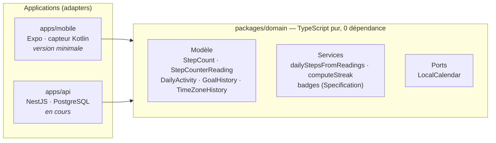

# StepByStep

[](https://github.com/GregoireChevalierACS/StepByStep/actions/workflows/ci.yml)
[](https://github.com/GregoireChevalierACS/StepByStep/actions/workflows/codeql.yml)

Application Android de comptage de pas (Samsung Galaxy S22), écrite en **TypeScript** et développée en **TDD**, autour d'un domaine métier pur partagé entre le téléphone et un serveur de synchronisation optionnel.

| Indicateur (domaine)   | Valeur                                                                     |
| ---------------------- | -------------------------------------------------------------------------- |
| Tests                  | 192, en moins d'une seconde                                                |
| Couverture             | 100 % (lignes, branches, fonctions), imposée en CI                         |
| Score de mutation      | 100 % ([Stryker](https://stryker-mutator.io)), seuil bloquant à 80 % en CI |
| Dépendances du domaine | aucune                                                                     |

## Le problème métier

Le téléphone fournit un compteur matériel de pas (`TYPE_STEP_COUNTER`) **cumulé depuis le dernier démarrage**. L'application relève ce compteur régulièrement et en déduit les pas de chaque jour. Les difficultés sont toutes métier :

- le compteur **repart à zéro** à chaque redémarrage, ce qu'on détecte grâce au numéro de démarrage Android (`BOOT_COUNT`) ;
- les pas faits entre deux relevés qui encadrent **minuit** sont répartis **au prorata du temps**, sans perdre ni inventer un seul pas ;
- les relevés peuvent arriver **en retard, en double ou dans le désordre** (synchronisation hors ligne) : le résultat doit rester identique ;
- le **fuseau horaire** de l'appareil change en voyage, et l'**objectif quotidien** peut changer sans réécrire les séries passées.

Ces règles vivent dans `packages/domain`, testées par l'exemple, par propriétés ([fast-check](https://fast-check.dev)) et par mutation.

## Architecture

Architecture **hexagonale** (ports et adapters) : les dépendances pointent toujours vers le domaine, qui ne connaît ni React, ni Expo, ni NestJS, ni aucune base de données.



La règle est vérifiée automatiquement, à deux niveaux : ESLint signale dans l'éditeur tout import de framework dans le domaine, et [dependency-cruiser](https://github.com/sverweij/dependency-cruiser) contrôle en CI le graphe complet des dépendances (`pnpm lint:architecture`) : domaine sans aucune dépendance externe, apps limitées à l'API publique du domaine, aucun cycle, code de production indépendant du code de test et des dépendances de développement, accès à la base (TypeORM, `pg`) réservé aux adapters de l'API.

## Démarrer

Prérequis : Node 22, pnpm 10, Docker (pour la base PostgreSQL de l'API).

```bash
pnpm install
pnpm test            # tous les tests
pnpm test:coverage   # tests + couverture (seuil 100 % sur le domaine)
pnpm test:mutation   # test de mutation Stryker du domaine (~1 min)
pnpm lint && pnpm typecheck && pnpm format:check
```

API (NestJS) avec sa base locale, depuis la racine du dépôt (Docker lancé) :

```bash
pnpm db:up                                   # PostgreSQL 18, attend qu'il soit prêt
cp apps/api/.env.example apps/api/.env       # configuration locale (validée au démarrage)
pnpm build                                   # domaine + API
pnpm db:migrate                              # applique les migrations (ou « Base à jour »)
cd apps/api
node --env-file=.env dist/main.js            # API sur le port 3000
```

L'API occupe ce terminal : la suite se fait dans un autre, à la racine du dépôt. Vérification : <http://localhost:3000/v1/health> répond `"status":"ok"`, et le contrat est consultable sur <http://localhost:3000/v1/docs> (Swagger UI). Les routes d'un appareil exigent un jeton : `POST /v1/devices` renvoie un `secret`, `POST /v1/devices/{deviceId}/tokens` l'échange contre un jeton de 15 minutes, à coller dans le bouton « Authorize » de Swagger. Pour tout arrêter : `Ctrl+C` puis `pnpm db:down`.

App mobile (Expo, dev build sur le S22) : un écran qui lit le compteur de pas matériel via un module natif Kotlin et envoie le relevé à l'API. Prérequis : JDK 17, SDK Android, débogage sans fil activé sur le téléphone ([ROADMAP, annexe](ROADMAP.md#8-annexe--déploiement-sans-câble-usb)). `<IP>:<PORT>` est l'adresse affichée sur l'écran « Débogage sans fil » ; le port change à chaque réactivation.

```bash
adb connect <IP>:<PORT>
adb -s <IP>:<PORT> reverse tcp:3000 tcp:3000      # localhost:3000 du téléphone → API du PC
adb -s <IP>:<PORT> reverse tcp:8081 tcp:8081      # Metro (bundler JS)
adb -s <IP>:<PORT> reverse --list                 # contrôle : les deux redirections doivent apparaître
pnpm --filter @stepbystep/mobile start            # lance Metro ; ouvrir ensuite l'app sur le téléphone
```

`-s` cible le téléphone par son adresse : ADB le voit souvent une seconde fois, découvert automatiquement (mDNS), et refuse alors toute commande sans `-s` (« more than one device »).

Selon les cas :

| Situation                                                         | Commande                                                                                                                                                                                                                 |
| ----------------------------------------------------------------- | ------------------------------------------------------------------------------------------------------------------------------------------------------------------------------------------------------------------------ |
| `adb connect` échoue (« failed to connect ») : association perdue | Sur le téléphone, « Associer l'appareil avec un code d'association », puis `adb pair <IP>:<PORT_D_ASSOCIATION> <CODE>` et de nouveau `adb connect <IP>:<PORT>`                                                           |
| App pas encore installée (ou module natif modifié)                | `pnpm --filter @stepbystep/mobile android` : compile, installe et lance Metro. Si le téléphone apparaît deux fois dans `adb devices`, déconnecter d'abord l'entrée mDNS : `adb disconnect "<nom>._adb-tls-connect._tcp"` |
| L'app affiche 404 « Appareil inconnu » (base réinitialisée)       | `adb -s <IP>:<PORT> shell pm clear com.stepbystep.app` : l'app oublie son appareil et s'enregistre de nouveau au prochain envoi                                                                                          |

Vérifier en base les derniers relevés reçus :

```bash
docker compose exec postgres psql -U stepbystep -d stepbystep -c "SELECT device_id, taken_at, boot_count, steps_since_boot, received_at FROM step_counter_readings ORDER BY received_at DESC LIMIT 5;"
```

Sous Windows, la compilation native dépasse la limite de 260 caractères des chemins : activer `LongPathsEnabled` et utiliser une CMake dont le ninja les gère (`android.cmakeVersion=4.1.2` dans `~/.gradle/gradle.properties`).

## Qualité et garde-fous

| Niveau              | Outil                                                                                                                        |
| ------------------- | ---------------------------------------------------------------------------------------------------------------------------- |
| Typage              | TypeScript `strict` + `noUncheckedIndexedAccess`, `exactOptionalPropertyTypes`, `verbatimModuleSyntax`                       |
| Lint / format       | `typescript-eslint` (`strictTypeChecked`), Prettier                                                                          |
| Architecture        | dependency-cruiser : sens des dépendances, cycles, API publique du domaine, base réservée aux adapters                       |
| Avant chaque commit | Husky + lint-staged + commitlint (format `aaaa-mm-jj # N : (type) message`)                                                  |
| Tests               | Vitest, fast-check (propriétés), Stryker (mutation)                                                                          |
| CI (GitHub Actions) | audit des dépendances, commitlint, lint, format, types, tests + couverture, mutation ; `main` protégée (PR + CI obligatoire) |
| Sécurité            | CodeQL, Dependabot (dépendances et actions)                                                                                  |

Erreurs métier sous forme de `Result<T, E>` plutôt que d'exceptions, Value Objects immuables validés à la création, invariants garantis par le type (historiques jamais vides).

## Décisions et feuille de route

- [ADR 0001](docs/adr/0001-historique-sans-health-connect.md) : historique construit par l'application, sans Health Connect.
- [ADR 0002](docs/adr/0002-serveur-de-synchronisation-optionnel.md) : serveur de synchronisation optionnel (NestJS + PostgreSQL).
- [ROADMAP](ROADMAP.md) : phases, patterns et stratégie de tests.

| Phase                                                      | État        |
| ---------------------------------------------------------- | ----------- |
| 0. Fondations (monorepo, CI, débogage sans fil)            | en partie   |
| 1. Domaine en TDD                                          | ✅ terminée |
| 8. Serveur de synchronisation NestJS                       | en cours    |
| App mobile minimale (capteur Kotlin, envoi à l'API)        | ✅ terminée |
| 2 à 5. Cas d'usage, adapters, écrans, arrière-plan mobiles | à venir     |
